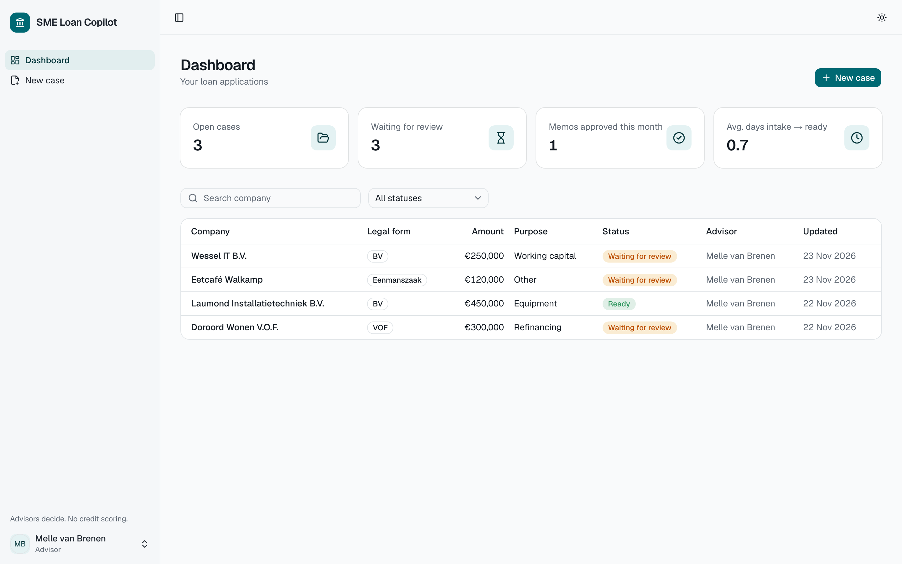
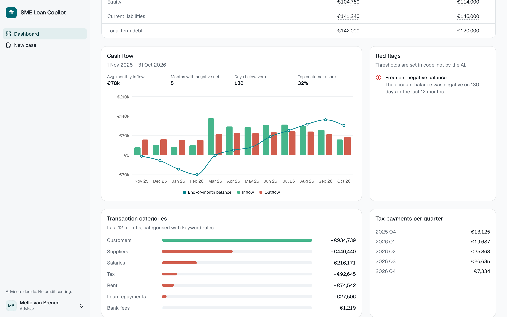
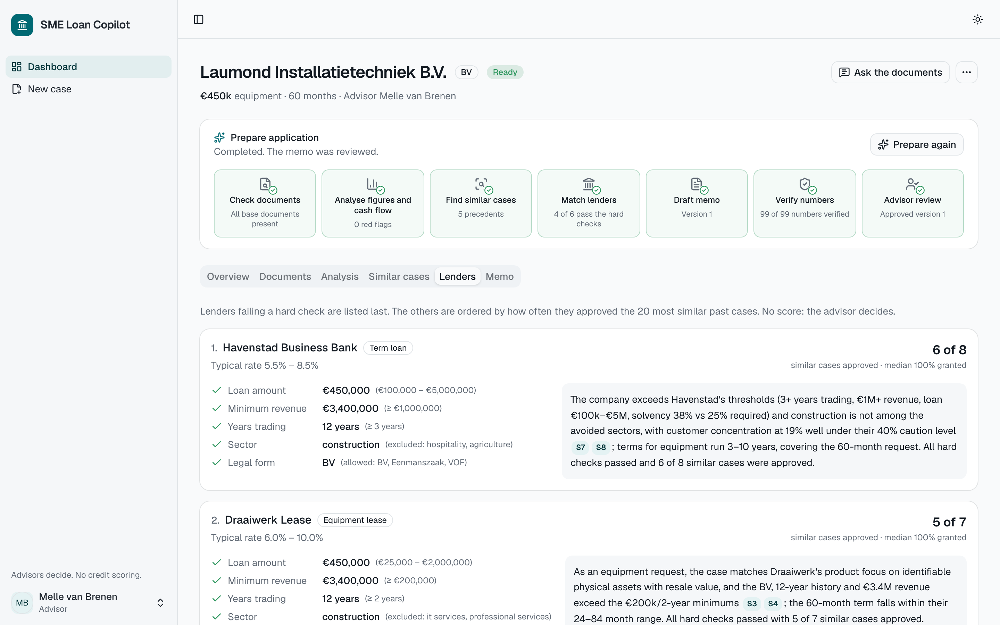
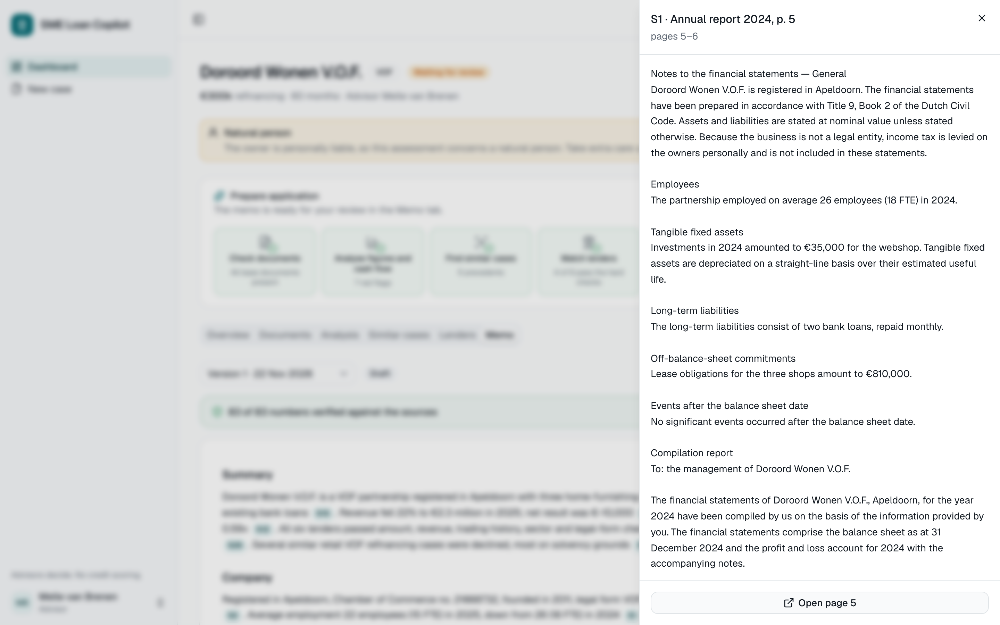
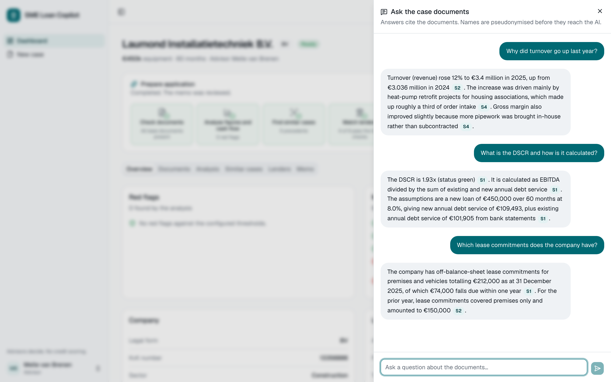
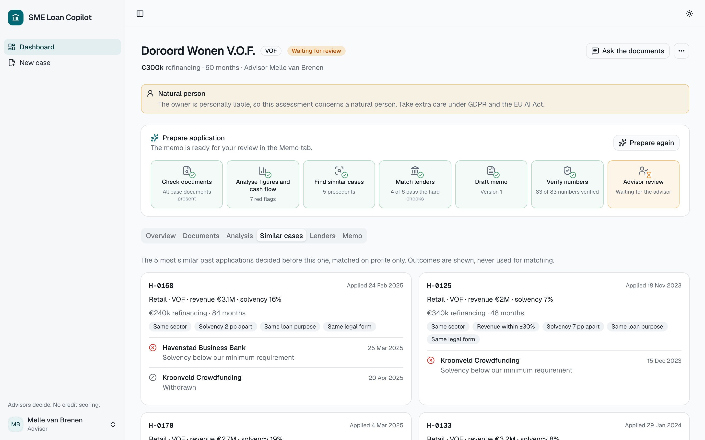
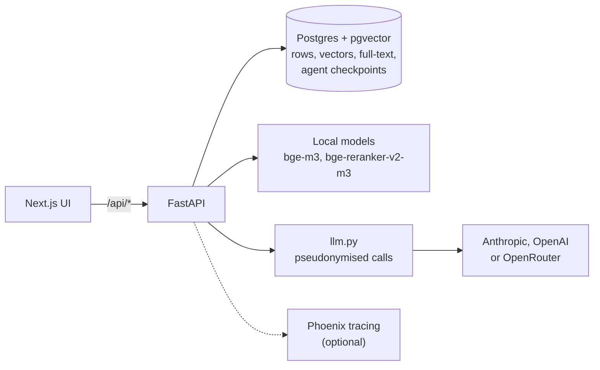

# SME Loan Copilot

SME Loan Copilot helps loan advisors prepare SME loan applications. Upload a company's annual reports and bank statements; it extracts the figures, analyses cash flow, finds similar past cases and the lenders that approved them, and drafts a cited loan memo. Every number is computed in code and verified, and the advisor makes every decision.

| Dashboard | Analysis |
|---|---|
|  |  |
| **Lender matching** | **Cited memo** |
|  |  |
| **Chat with the documents** | **Similar cases** |
|  |  |

More screens, in light and dark, are in [`docs/screenshots/`](docs/screenshots/).

## Features

- **Figures and ratios:** the LLM reads the annual-report tables; code checks every figure against its page and the accounting identities, then calculates the ratios and the DSCR.
- **Cash-flow analysis** of 12 months of bank transactions (CAMT.053 or CSV): monthly flows, overdraft days, customer concentration, tax payments and red flags.
- **Similar past cases**, with the lenders that approved or declined them, found only among cases decided before the application date.
- **Lender matching:** hard checks against each lender's criteria, precedent counts and a fit summary that cites the criteria documents. No single score.
- **A cited loan memo**, drafted by an agent that verifies every number and redrafts when one does not match, then waits for the advisor to approve it or request changes.
- **Chat with the case documents**, with streamed answers, `[S1]` citations and a source panel showing the page.

## Architecture



More diagrams, covering ingestion → retrieval → generation and the agent graph, are in [`docs/architecture.md`](docs/architecture.md). The design decisions are in [`docs/adr/`](docs/adr/).

## How the RAG pipeline works

1. **Ingestion:** uploads are parsed in the background. Docling turns PDFs into per-page markdown with tables kept, and statements become transaction rows.
2. **Chunking:** sections split by headings (200–700 tokens) and whole tables, each with its page range and a context header.
3. **Embeddings:** bge-m3 runs locally, with normalised vectors; `make reindex` re-embeds everything.
4. **Storage:** Postgres only, with pgvector (HNSW) for dense search and a generated `tsvector` for keyword search ([ADR 0001](docs/adr/0001-postgres-only-rag.md)).
5. **Retrieval:** dense top 40 + keyword top 40, fused with Reciprocal Rank Fusion. The access filter is inside the SQL.
6. **Reranking:** a local cross-encoder narrows the top 30 to the top 6 (chat) or 8 (memo).
7. **Generation:** numbered `<source>` blocks, a citation on every factual sentence and an exact can't-find reply, streamed over SSE. Prompts are versioned files.
8. **Agentic loop:** a LangGraph agent prepares the application and pauses for human review ([architecture](docs/architecture.md#prepare-application-agent)).
9. **Evaluation:** retrieval ablation, answer faithfulness, extraction accuracy, a leakage-free backtest on history, and memo verification ([results](docs/eval-results.md)).
10. **Observability:** every LLM call is logged with tokens, latency, cost and source IDs, and shown in the admin audit log; OpenTelemetry spans can go to Phoenix.
11. **Serving:** FastAPI under `/api` and the Next.js UI; `make dev` runs both.
12. **Security:** access control in every query, pseudonymisation, injection flagging, upload checks, erasure on delete and security headers.
13. **Repo basics:** Docker Compose, Makefile, CI (lint, tests, check-no-data), ADRs and this README.

## Evaluation

Retrieval on 48 golden questions over the synthetic demo cases (latency is retrieval only, on CPU):

| Pipeline | Recall@5 | MRR@10 | Faithfulness | p95 latency |
|---|---|---|---|---|
| Dense only | 97.9% | 0.688 | — | 136 ms |
| Keyword only | 87.5% | 0.567 | — | 7 ms |
| Hybrid (RRF) | 97.9% | 0.743 | — | 137 ms |
| Hybrid + rerank | 91.7% | 0.743 | 1.000 | 11,049 ms |

With GLM 5.3 Flash (via OpenRouter) as both the model and the judge:
- **Answers:** faithfulness 1.000, answer relevancy 0.636. All 5 unanswerable questions got the "can't find" reply, and no answerable question did.
- **Extraction:** 100% of figures within 0.5% across 20 annual reports in three layouts, with no validation warnings.
- **Memo verification:** 3 of 4 first drafts had every number verified; after one redraft all 4 did (337 numbers checked).

Backtest on the 46 most recent historical cases, where each sees only cases decided before its application date:
- **Lender hit@3:** 93.1%, against 66.0% for a random order and 79.3% for "most popular lender first".
- **Precedent agreement:** 43.5%, below the 58.7% of always predicting the most common outcome.
- **Amount coverage:** 21.4%.

So precedents are shown as context, never as a prediction. The reranker runs on CPU, which is why it dominates latency; it is the step to move to a GPU or drop when speed matters more than ranking.

See [`docs/eval-results.md`](docs/eval-results.md) for every table and how to read them. The evaluation runs locally against synthetic data (`make eval EVAL_DIR=…`); CI never runs it.

## Privacy and compliance by design

- **Human in the loop, no credit scoring.** The app never approves, declines or scores. It shows checks, precedents and cited passages, and the advisor decides ([ADR 0003](docs/adr/0003-human-in-the-loop.md)).
- **Numbers from code, and verified.** The LLM only extracts figures (which code validates) and writes prose. Every number in a memo is checked against known values ([ADR 0002](docs/adr/0002-numbers-from-code.md)).
- **Pseudonymisation before LLM calls.** Company and contact names are replaced with placeholders before a prompt leaves the server, and restored in the reply.
- **Access control in retrieval.** An advisor's search can only reach their own cases, because the filter is part of the SQL, not applied afterwards.
- **Natural-person banner.** Sole traders and partnerships are natural persons under the GDPR, and the case page says so.
- **Erasure on delete.** Deleting a case removes its files, rows, chunks and agent checkpoints; the audit log keeps metadata only.
- **Injection flagging.** Documents containing text that looks like instructions to an AI are flagged and kept out of the LLM's context until an advisor allows them.

This is a portfolio project, not legal advice.

## Quickstart

Requirements:
- Docker
- Python 3.12 with [uv](https://docs.astral.sh/uv/)
- Node with pnpm
- An Anthropic, OpenAI or OpenRouter API key
- A few GB of disk space: the embedding and reranker models download on first use.

```bash
cp .env.example .env   # add one API key and set LLM_MODEL to a model from that provider
```
```bash
docker compose up -d   # Postgres + pgvector on port 5433
```
```bash
make setup             # install dependencies, run migrations
```
```bash
make dev               # http://localhost:3000
```

Open <http://localhost:3000/setup> to create the first admin. The app starts empty: no users, cases or lenders. Add `--profile tracing` to the Compose command to run Phoenix on :6006.

| Command | What it does |
|---|---|
| `make test` / `make lint` / `make fmt` | pytest + tsc / ruff + Biome / auto-fix |
| `make migrate` | Apply database migrations |
| `make schema` | Regenerate the import format document |
| `make reindex` | Re-embed all chunks and case cards |
| `make eval EVAL_DIR=…` | Run the evaluation and write `docs/eval-results.md` |
| `make check-no-data` | Fail if data files or API keys are tracked by git |

## Importing your own historical cases

Similar cases and lender precedents come from your own history. An admin imports it as JSON Lines in **Admin → History import**. Each line is one pseudonymous case with its company profile, financials and lender decisions, with no names. The format is documented in [`docs/import-format.md`](docs/import-format.md), which `make schema` generates from the code.

## Tech stack

| Area | Choice |
|---|---|
| API | Python 3.12, uv, FastAPI, Pydantic v2, SQLAlchemy 2 + Alembic, psycopg 3 |
| Database | PostgreSQL 17 + pgvector, full-text search |
| Documents | Docling (PDF), CAMT.053 and CSV parsers |
| Models | bge-m3 embeddings and bge-reranker-v2-m3 via sentence-transformers, run locally |
| LLM | Anthropic, OpenAI or OpenRouter through one module (`llm.py`) |
| Agent | LangGraph with the Postgres checkpointer |
| Tracing | OpenTelemetry → Arize Phoenix (optional) |
| Web | Next.js App Router, TypeScript, Tailwind, shadcn/ui, Recharts, Biome |
| Dev | Docker Compose, Makefile, GitHub Actions |

## Synthetic data

All data shown in screenshots is synthetic. Companies, people, lenders and figures are fictional.

Demo data and evaluation sets are generated and loaded by scripts that are never committed ([ADR 0004](docs/adr/0004-local-demo-data.md)). A fresh clone is an empty, working app.

## License

[MIT](LICENSE)
