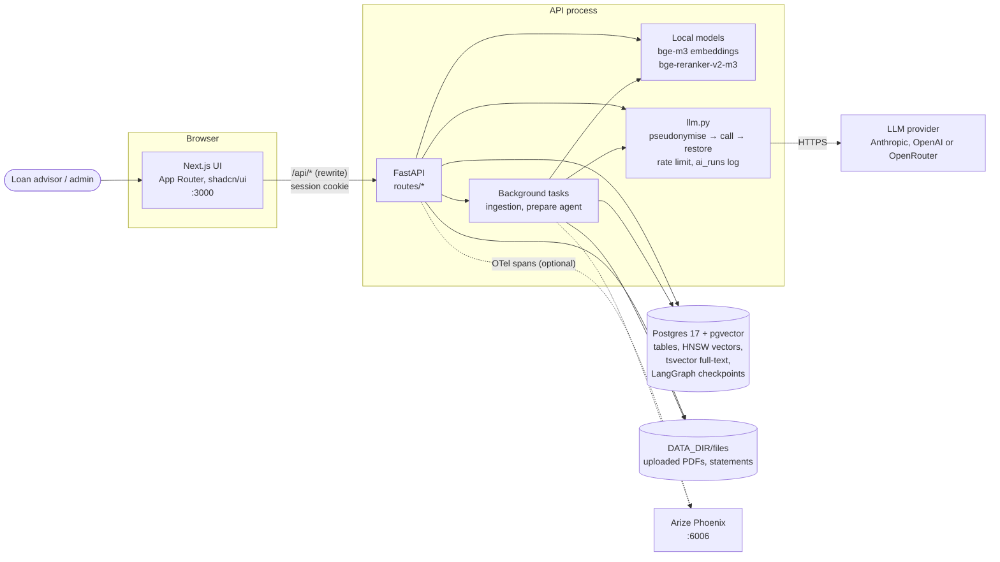
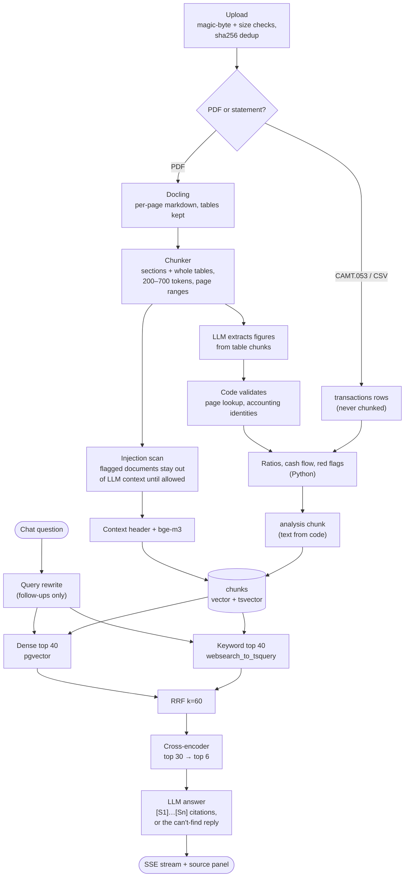
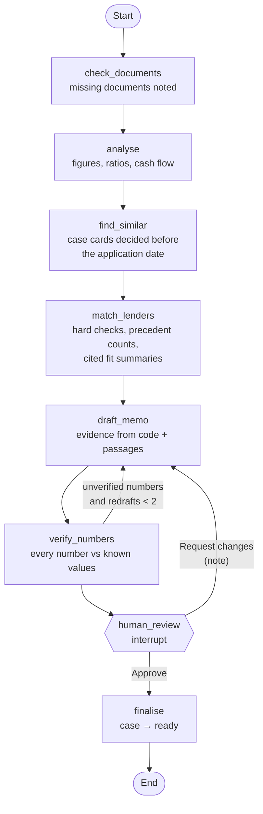

# Architecture

SME Loan Copilot is two apps and one database: a Next.js UI, a FastAPI backend and
Postgres with pgvector. Embeddings and reranking run locally; only `llm.py` talks to an
LLM provider, and it pseudonymises names before every call. Decisions behind this design are
in [`adr/`](adr/).

## System

| Part | Where | Notes |
|---|---|---|
| UI | `apps/web/src/` | Every screen has empty, loading and error states |
| API | `apps/api/src/loancopilot/routes/` | All under `/api`; access control through `allowed_case_ids` |
| Domain code | `apps/api/src/loancopilot/*.py` | One module per concern; plain functions |
| Database | `models.py`, `alembic/` | One Postgres for rows, vectors, full-text and agent checkpoints |
| Evaluation | `apps/api/eval/` | Code only; data comes from `EVAL_DIR` |

## Ingestion → retrieval → generation

The access filter is part of the retrieval SQL (`Chunk.case_id IN allowed_case_ids(user)`),
so another advisor's chunks are never even candidates.

## "Prepare application" agent

A LangGraph graph with the Postgres checkpointer; thread id `{case_id}:{run_number}`. Each
node updates `prepare_runs.steps`, which the UI polls.

The graph never decides on the loan. "Approve" means the advisor approves the memo text;
the credit decision stays with the advisor and the lender.
